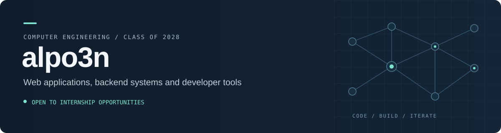

  

I'm **alpo3n** (Aditya), a **Computer Engineering student at Shah & Anchor Kutchhi Engineering College**, graduating in **2028**. I build Python applications and work with machine learning, NLP and retrieval-augmented generation.

**Currently looking for an AI/ML internship.** I'm interested in model evaluation, LLM applications and the backend work that connects them to an interface people can use.

[Explore my repositories](https://github.com/adii-madhavi?tab=repositories) · [Try PauseCheck](https://pausecheck.vercel.app) · [Portbridge release](https://github.com/adii-madhavi/mcp-converter/releases/latest)

## AI and machine learning

| Project | What it does | Main tools |
| :--- | :--- | :--- |
| **[MANDO](https://github.com/adii-madhavi/hhgoa-mando-rag)** | Multilingual RAG assistant with vector search, evidence checks and language-specific evaluation. | Python · FastAPI · Sentence Transformers · Qdrant |
| **[CommentScope](https://github.com/adii-madhavi/youtube-comment-filter)** | YouTube comment dashboard with local RoBERTa sentiment analysis, review flags, filters and CSV export. | Python · Flask · ONNX Runtime |
| **[Image Restoration](https://github.com/adii-madhavi/kla-image-restoration)** | Grayscale denoising and 2× super-resolution pipeline for semiconductor inspection, with training and inference tools. | Python · PyTorch · NumPy |
| **[Wine Quality Prediction](https://github.com/adii-madhavi/wine-quality-prediction-system)** | Compares four classification models using cross-validation, with a Streamlit interface for predictions and evaluation. | scikit-learn · pandas · Streamlit |

## Tools you can try

**[PauseCheck](https://github.com/adii-madhavi/pausecheck)** — A browser-local message explainer that highlights common warning patterns and suggests ways to verify a request. [Open the demo →](https://pausecheck.vercel.app)

**[Portbridge](https://github.com/adii-madhavi/mcp-converter)** — Moves MCP configuration files between Windows, macOS and Linux, with a change report and credential redaction. [Download the web app →](https://github.com/adii-madhavi/mcp-converter/releases/latest)

## Technical toolkit

**Languages** &nbsp; Python · JavaScript · TypeScript  
**ML and retrieval** &nbsp; PyTorch · scikit-learn · NumPy · pandas · Sentence Transformers · Qdrant  
**Applications** &nbsp; FastAPI · Flask · Streamlit · React · REST APIs  
**Development** &nbsp; Git · GitHub · Jupyter Notebook · pytest

---

Project READMEs include setup instructions, implementation details and current limitations.
